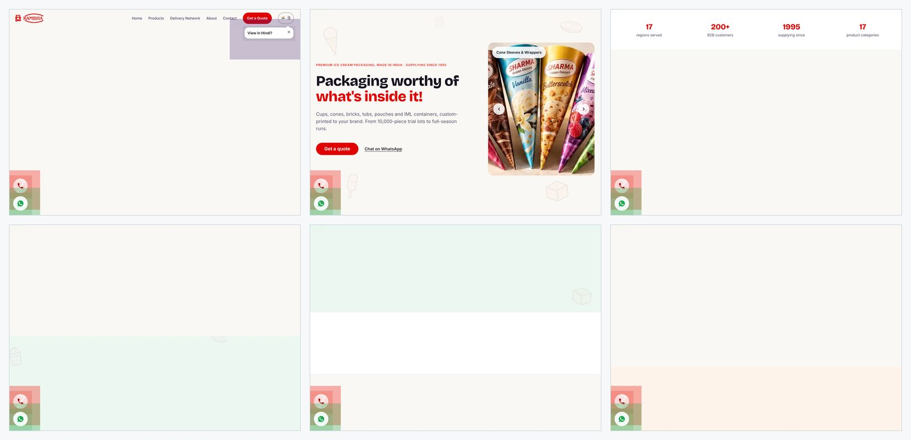
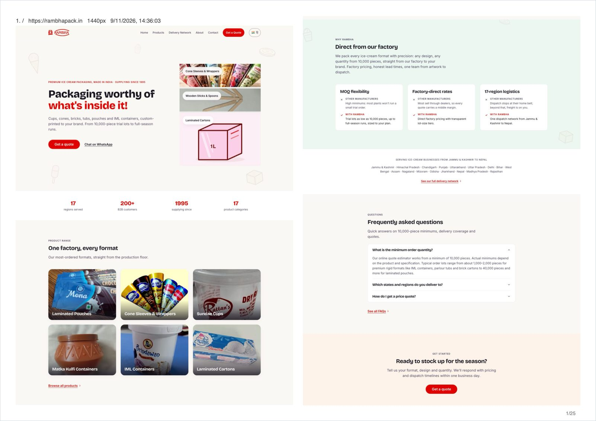
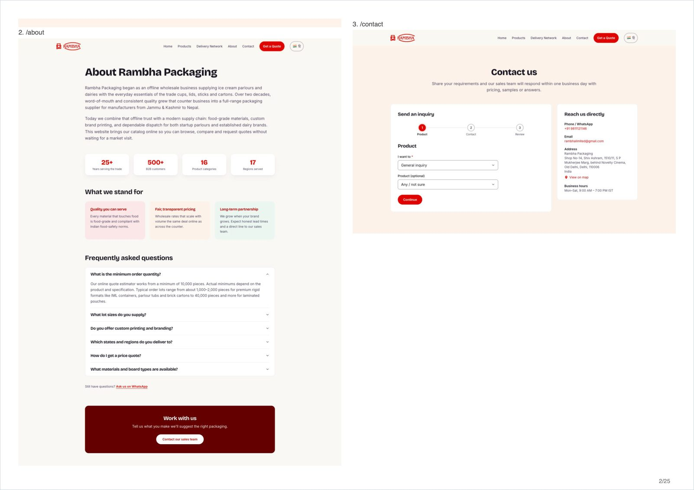

<div align="center">


# site2paper

**Print any website the way visitors see it.**
A website-to-PDF CLI: full-page screenshots of every page, every carousel slide,
flowed into a few A4 sheets you can mark up with a pen.

[](https://github.com/piyushagru/site2paper/actions/workflows/ci.yml)
[](LICENSE)
[](package.json)
[](https://playwright.dev)
[](https://github.com/piyushagru/site2paper)

```
npx site2paper https://your.site
```

[Quick start](#quick-start) · [Before and after](#before-and-after) · [How it works](#how-it-works) · [Options](#options) · [FAQ](#faq)

</div>

---

## What it is

site2paper is a one-command CLI. You give it a URL. It finds every page, opens each one in a real
browser, takes a full-length shot of what a visitor sees, and lays all of them into one small PDF.

**The goal:** review a whole website on paper, in one sitting, with a red pen. Designers, founders,
copy editors and clients can spot what is wrong without clicking through 50 tabs.

## Before and after

Same site, same machine, same run: a 48-page catalogue site at 1440px.

**Before: Ctrl+P (Chrome Print-to-PDF), first 6 of 171 sheets**



**After: site2paper, sheet 1 of 25**



<details>
<summary>Sheet 2: pages flow on, each one kept whole</summary>



</details>

| | Ctrl+P | site2paper |
|---|---|---|
| Sheets | 171 | **25** |
| File size | 75.6 MB | **6.4 MB** |
| Looks like | the print stylesheet | the screen |
| Carousel slides | the first one | **all of them, as a grid** |
| Sticky header, chat bubble, cookie bar | on every sheet | hidden |
| Footer | on every page | once, at the end |
| Page cut mid-card | often | never |
| A page that errors | blank or missing | retried, then listed in `report.json` |

See it on your own site:

```
npx site2paper https://your.site --format compare
```

## Features

| Capability | Implementation |
|---|---|
| **Page discovery** | Parses `sitemap.xml` and sitemap indexes. Falls back to a breadth-first same-origin crawl. URLs are normalized and deduplicated. |
| **Browser resolution** | Playwright launches the installed Chrome or Edge via `channel`. Headless Chromium is fetched only if neither is found. |
| **Carousel normalization** | Swiper, Slick, Embla, Keen, Splide, Flickity, Owl, Bootstrap and `aria-roledescription="carousel"` tracks are reflowed into a CSS grid. Nav controls are dropped. |
| **Overlay suppression** | Consent management platform (CMP) banners are hidden by selector, never clicked. `position: fixed` and `sticky` nodes are removed. The top header is set static. |
| **Lazy-load hydration** | Incremental viewport scroll fires `loading="lazy"` and `IntersectionObserver` content. Capture waits for `networkidle`. Animations are disabled. |
| **Whitespace-aware pagination** | Each shot gets a per-row variance map. Pages flow through N columns. A page that fits a column is never split. Taller pages are cut on the nearest blank row. |
| **Fault tolerance** | Failed URLs go to a deferred retry queue, 2 rounds by default. Residual failures are written to `report.json`, and the process exits `3`. |
| **Output formats** | `book`, `sheet`, `native` (Chrome Print-to-PDF), `compare`. A4 or Letter, portrait or landscape, 1 to 4 columns. JPEG-encoded slices keep the PDF small. |
| **Viewport emulation** | Any width: `1440` desktop, `768` tablet, `390` phone. |

## Quick start

Needs Node 20.9 or newer.

```
npx site2paper https://your.site
```

Output: `./site2paper/your.site-<date>-1440px-book.pdf` plus `report.json`.

```
npx site2paper https://your.site --width 390              # phone view
npx site2paper https://your.site --columns 3 --paper letter
npx site2paper http://127.0.0.1:3000                      # your dev server
npx site2paper https://your.site --pages urls.txt         # only these pages
```

## How it works


1. **Discover.** `sitemap.xml` first, sitemap indexes followed. Else a breadth-first crawl. Home first, shallow paths before deep. Cap: 50.
2. **Prepare.** CSS and a small script run in the headless browser only, never on your site.
3. **Capture.** One full-length PNG per page.
4. **Lay out.** Shots are sliced and placed down the columns. The footer is kept on the last page only.
5. **Report.** Exit code `0` when every page made it, `3` when some were left out.

## Options

| Flag | Default | What it does |
|---|---|---|
| `--width <px>` | `1440` | Viewport width. `768` for tablet, `390` for phone |
| `--format <name>` | `book` | `book`, `sheet` (one page per sheet), `native` (Chrome Print-to-PDF), `compare` (book and native plus the table) |
| `--columns <n>` | `2` | Columns per sheet for `book` |
| `--paper <size>` | `a4` | `a4` or `letter` |
| `--portrait` | off | Portrait sheets |
| `--pages <file>` | | Use these URLs instead of discovering them, one per line |
| `--limit <n>` | `50` | Max pages to discover |
| `--hide <css>` | | Extra selectors to hide, comma separated |
| `--retries <n>` | `2` | Retry rounds for failed pages |
| `--out <path>` | `./site2paper/` | Output file (`.pdf`) or directory |
| `--quiet` | off | No progress output |

## FAQ

Common problems people hit when they try to print a website, and what site2paper does about each.

<details>
<summary><b>Ctrl+P only saves the first screen of the page.</b></summary>

The page scrolls inside a box with a fixed height, so print stops at that box
([more](https://blog.rottenwifi.com/how-to-fix-webpage-pdfs-that-save-only-the-first-screen/)).
site2paper takes a screenshot of the whole document instead of printing it, so the full length is captured.
</details>

<details>
<summary><b>The sticky header is printed on top of every page.</b></summary>

`position: fixed` elements repeat on each printed page and cover text
([more](https://stackoverflow.com/questions/39515333/html-to-print-pdf-css)).
site2paper makes the top header static, so it shows once, and removes other fixed and sticky parts.
</details>

<details>
<summary><b>My carousel shows only one slide in the PDF.</b></summary>

Print and screenshots catch whichever slide is showing. site2paper lays the slides of common carousel
libraries out as a grid, so every slide is on paper.
</details>

<details>
<summary><b>Images are grey boxes in my full-page screenshot.</b></summary>

Lazy images load only when they scroll into view
([more](https://screenshotone.com/blog/a-complete-guide-on-how-to-take-full-page-screenshots-with-puppeteer-playwright-or-selenium/)).
site2paper scrolls each page end to end and waits before the shot.
</details>

<details>
<summary><b>A cookie banner covers the middle of the shot.</b></summary>

A headless browser is a new visitor every time, so it always gets the banner
([more](https://dev.to/framejet/why-your-headless-screenshots-have-a-cookie-banner-over-them-and-how-to-get-rid-of-it-4gg0)).
site2paper hides known consent banners (OneTrust, Cookiebot, Sourcepoint, Didomi, Usercentrics and generic ones). It never clicks "accept".
</details>

<details>
<summary><b>How do I save a whole site, not one page, as one PDF?</b></summary>

Browsers print one page at a time. Acrobat and paid web services can crawl a site. site2paper does it
free, locally, in one command, and the PDF is small enough to print.
</details>

<details>
<summary><b>Does it work on a site that needs a login, or on localhost?</b></summary>

Localhost: yes, point it at your dev server. Login: not yet. Pass the public pages with `--pages`.
</details>

## How it compares

| Tool | Best for | Output |
|---|---|---|
| [site2pdf](https://github.com/laiso/site2pdf) | Site text for LLMs and RAG | Merged Print-to-PDF |
| [website2pdf](https://github.com/jgazeau/website2pdf) | Sitemap to PDFs, header and footer templates | One PDF per page, optional merge |
| [shot-scraper](https://shot-scraper.datasette.io/) | Scripted screenshots from YAML | One image per URL |
| **site2paper** | **Reviewing a site on paper, as visitors see it** | **One small book PDF** |

## Prior art

These open-source projects cover parts of the same problem. site2paper is its own implementation and copies no code from them.

| Project | Author | Licence | What it does |
|---|---|---|---|
| [site2pdf](https://github.com/laiso/site2pdf) | laiso | MIT | Prints pages from a site and merges them, aimed at text for LLMs and RAG |
| [website2pdf](https://github.com/jgazeau/website2pdf) | jgazeau | MIT | Prints one PDF per sitemap page, with optional header and footer templates |
| [shot-scraper](https://shot-scraper.datasette.io/) | simonw | Apache-2.0 | Takes scripted screenshots from a YAML list of URLs |
| [web-printer](https://github.com/ourongxing/web-printer) | ourongxing | MIT | Turns documentation sites into one PDF |

Licences were read from each project's GitHub page on 2026-11-09.

## Contributing

```
npm install
npm run lint && npm run check && npm test
node bin/site2paper.mjs https://example.com --limit 2 --format compare
```

See [AGENTS.md](AGENTS.md) for conventions and [CONTRIBUTING.md](CONTRIBUTING.md) for the PR flow.
Issues and ideas are welcome in [Issues](https://github.com/piyushagru/site2paper/issues).

---

<div align="center">

**Useful? [Star the repo](https://github.com/piyushagru/site2paper) so others can find it.**

[MIT](LICENSE) © 2026 Piyush Aggarwal

</div>
