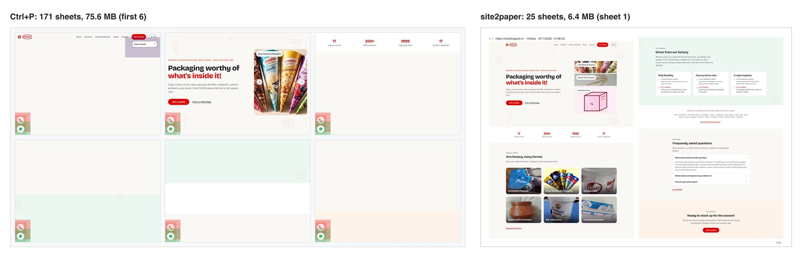
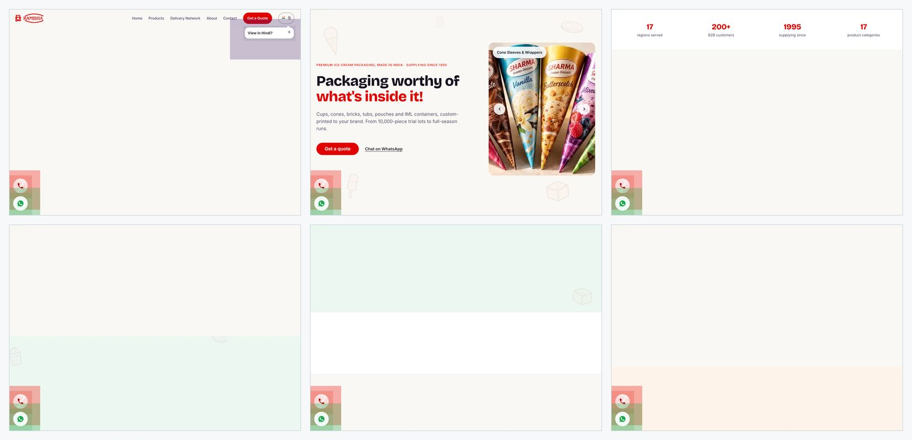
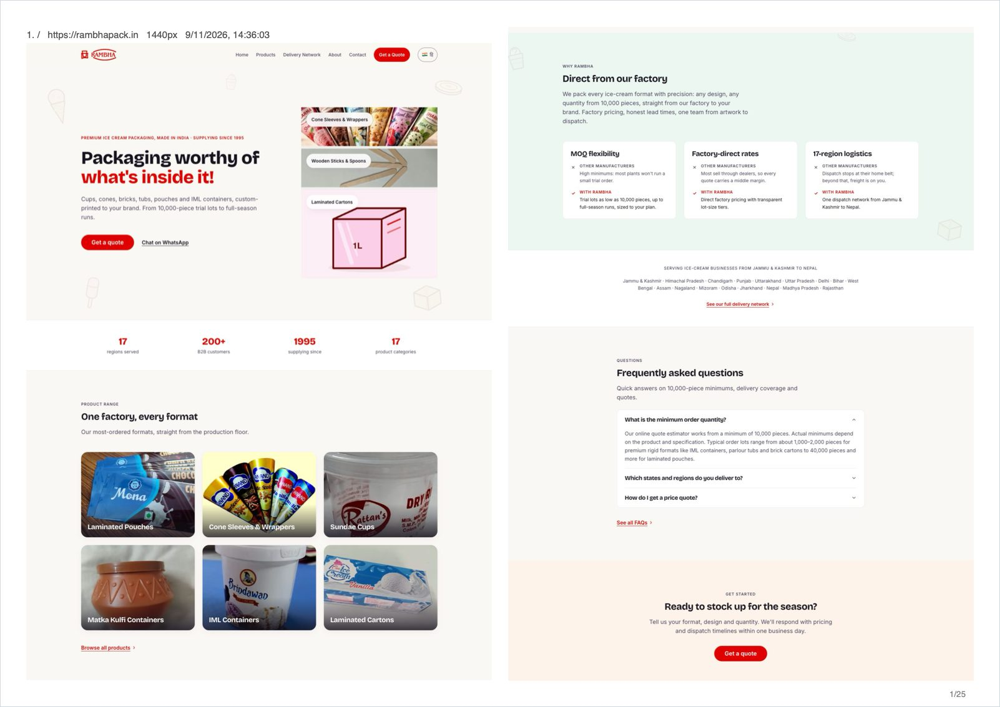
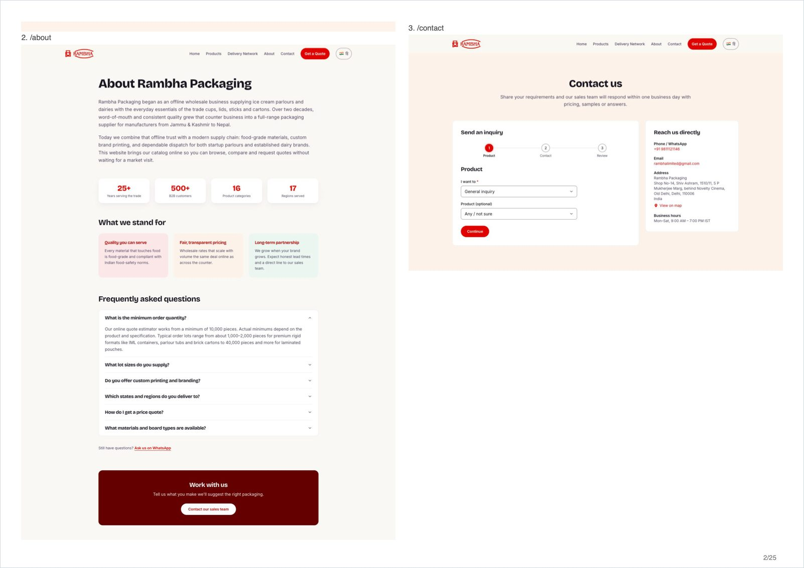
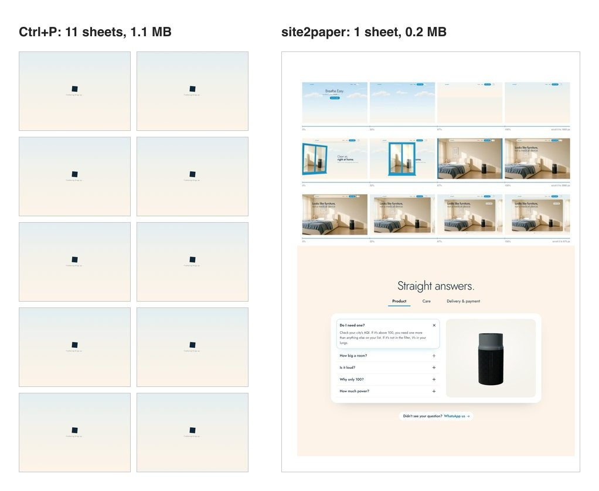
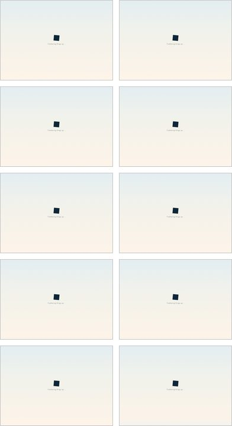
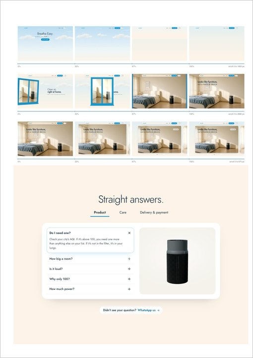

# Examples

Real runs, same machine, same day: Chrome's own Print-to-PDF (Ctrl+P) beside site2paper, both at
1440 px. Nothing was retouched except one URL label (see the scroll-story note below).

| Example | Site type | Ctrl+P | site2paper | Folder |
|---|---|---|---|---|
| Catalogue site, 48 pages | Swiper hero carousel, language pop-up, floating call and chat widgets | 171 sheets, 75.6 MB | 25 sheets, 6.4 MB | [`catalogue-site/`](catalogue-site/) |
| Scroll-story landing page, home only | Three pinned scroll sections, three.js sky and product, scroll-reveal text | 11 sheets, 1.1 MB, 10 of them the preloader cube | 1 sheet, 0.2 MB, three filmstrips | [`scroll-story-site/`](scroll-story-site/) |

## How to read a compare image

Left half is Ctrl+P, right half is site2paper, same pages, same order. Every sheet is one A4 page
of the PDF rendered to PNG and tiled. Where Ctrl+P repeats a slide or a pop-up on sheet after sheet,
site2paper prints the page once and moves on.

## Catalogue site



What went wrong in Ctrl+P and what site2paper did about it:

| Ctrl+P | site2paper |
|---|---|
| Every Swiper slide printed as its own near-blank sheet | Carousel track reflowed into a grid, all slides visible once |
| Language pop-up and cookie banner on top of every page | Hidden by selector, never clicked, so no reload or redirect |
| Floating call and chat buttons on every sheet | `position: fixed` and `sticky` nodes removed before capture |
| One page per sheet, half of each sheet empty | Two columns, pages cut only on blank rows, a page that fits a column is never split |

| Ctrl+P, first 6 of 171 sheets | site2paper, sheet 1 | site2paper, sheet 2 |
|---|---|---|
|  |  |  |

## Scroll-story landing page



This page is three scroll-driven stories: a frame pinned to the viewport while the user scrolls
through a tall section, with three.js and scroll-reveal text animating along the way. Ctrl+P prints
the runway as blank backdrop, and here the preloader never finished, so 10 of 11 sheets are the
loading cube.

site2paper detects each pinned section, scrolls it to 4 stops (0, 33, 67, 100 percent), screenshots
the viewport at each, and prints the four frames in a row with a scroll ruler in place of the
section. The static full-page shot is then taken on a second load with reduced motion, so the rest
of the page lands on its final frame.

| Ctrl+P, first 10 of 11 sheets | site2paper, sheet 1, left column |
|---|---|
|  |  |

The site owner asked that the site name stay out of the docs, so this example shows one column and
masks the URL label. Nothing else was touched.

## Reproduce

```sh
npx site2paper https://your.site --format compare
```

`compare` writes both PDFs beside each other and prints a table like the one at the top. The images
here were made by rendering each PDF page to PNG and tiling them.

For a quick local check without touching a real site, the repo ships a fixture:

```sh
node scripts/fixture-site.mjs &
npx site2paper <printed url> --format compare --out ./out
```

## Known limits shown here

- Pages taller than 32767 px are cut at that height and marked `truncated` in `report.json`.
  Stitching taller pages is roadmap item P1-8.
- Every page screenshot stays in memory until the PDF is written. Fine for these two sites, a risk
  for 50 very tall pages. Tracked in issue #1.
- `report.json` lists pages, failures and truncation, but not yet which pages are filmstrips.
  Per-page status is issue #2.

## Adding an example

- One folder per site, named after what the site is, not its host, unless the owner is fine with
  the name in public.
- Keep `compare.jpg` under 150 KB (JPEG quality 85, about 2300 px wide) so the README loads fast.
- Only sites you own or have permission to show. No customer screenshots.
- `examples/` is not in the npm package (`files` in `package.json`), so size here does not count
  against the packed-size budget.
